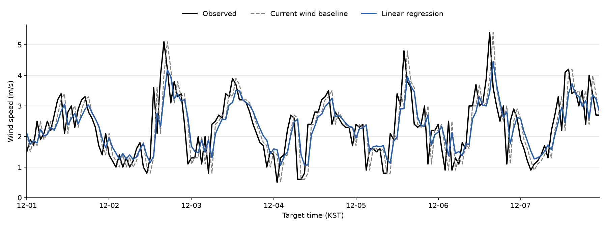

# Week 8 — 서울 ASOS 108번 1시간 뒤 풍속 예측 (회귀분석)

서울 ASOS 108번 관측소의 2023~2024년 시간별 자료(`asos_108_2023_2024.csv`)로
**현재와 과거 관측값 5개 → 정확히 1시간 뒤 풍속(m/s)** 을 예측했습니다. 시각은 KST입니다.
AI 도구는 Claude를 사용했습니다.

## 폴더 구성

| 파일 | 설명 |
|---|---|
| `asos_108_2023_2024.csv` | 배포 원본 (수정하지 않음) |
| `check_csv.py` | 실습 1: 행 수·중복·빠진 시각·빈칸 검사 |
| `make_dataset.py` | 실습 2: 입력 5개 + 정답 1개 표 → `wind_dataset.csv` |
| `train_eval.py` | 실습 3: 현재 풍속 유지 vs 선형회귀 → `predictions.csv` |
| `plot_week.py` | 실습 4: 12월 1~7일 비교 그래프 → `prediction_week.png` |
| `compare_models.py` | 선택 실습: 랜덤포레스트 추가 비교 |
| **`predictions.csv`** | 12월 평가 744행 (실제값, 기준 예측, 선형회귀 예측) |
| **`prediction_week.png`** | 일주일 비교 그래프 |

실행 순서: `check_csv.py` → `make_dataset.py` → `train_eval.py` → `plot_week.py` → `compare_models.py`
(필요 패키지: pandas, scikit-learn, matplotlib)

## 예측 문제

- 입력 5개: 현재 풍속, 1시간 전 풍속, 2시간 전 풍속, 현재 기온, 현재 습도
- 정답: 정확히 1시간 뒤의 실제 풍속
- 학습: 정답 시각 2023-01-01 03시 ~ 2024-11-30 23시 (16,720행)
- 평가: 정답 시각 2024-12-01 00시 ~ 12-31 23시 (744행). 평가 중에는 모델을 다시 학습하지 않음
- 비교 기준: "1시간 뒤에도 지금 풍속 그대로" (현재 풍속 유지)

## Claude에 준 요청과 직접 확인한 결과

| 단계 | Claude에 준 요청 (요약) | 직접 확인한 결과 |
|---|---|---|
| 1. CSV 확인 | 시각 순서, 행 수, 중복, 1시간 격자 기준 빠진 시각, 풍속·기온·습도 빈칸을 원본 수정 없이 검사 | 17,509행 / 중복 0 / 빠진 시각 35개(4구간) / 풍속 빈칸 33개, 기온·습도 빈칸 0 |
| 2. 입력·정답 표 | 빠진 시각을 빈 행으로 넣어 1시간 간격을 먼저 맞추고, 입력 5개와 1시간 뒤 정답을 한 행에 붙임. 빈 값은 채우지 않고 그 행만 제외 | 격자 17,544행 → 80행 제외 → **17,464행**. 모든 행의 `target_time − forecast_time` = 1시간. 전체 행을 원본 해당 시각 값과 대조해 일치 확인 |
| 3. 학습·평가 | 2024-11까지 학습, 12월만 평가, 선형회귀 학습, 음수 예측은 0, 두 방법 MAE 비교 | 학습 16,720 / 평가 744. MAE **0.653 → 0.595 m/s** (약 9.0% 감소). 음수 예측 0건 |
| 4. 그래프 | 12-01~07 실제(검정)·기준(회색 점선)·선형회귀(파랑) 한 그림, MAE는 12월 전체로 계산 | `prediction_week.png` 저장, 그림 직접 확인. `predictions.csv` 744행이 12월 1시간 격자와 정확히 일치, 빈 값 0 |
| 선택. 모델 비교 | 같은 입력·기간으로 랜덤포레스트(100그루, 깊이 6, 리프 5, seed 42) 추가 | MAE 0.5938 m/s. 선형회귀와 차이 0.0008 m/s |

## 결과

| 방법 | 12월 MAE | 기준 대비 |
|---|---|---|
| 현재 풍속 유지 | 0.6535 m/s | 기준 |
| 선형회귀 | 0.5946 m/s | −9.0% |
| 랜덤포레스트 | 0.5938 m/s | −9.1% |

선형회귀 계수는 `wind_now` +0.577, `wind_lag1` +0.168, `wind_lag2` +0.058, 기온 +0.0007, 습도 −0.0016입니다.
랜덤포레스트의 입력 중요도도 `wind_now`가 0.929로 거의 전부입니다.

## 분석: 크게 틀린 시각

오차가 큰 시각 상위 5개 (선형회귀 기준, 12월 전체):

| 정답 시각 | 실제 | 현재 풍속 유지 | 선형회귀 | 회귀 오차 |
|---|---|---|---|---|
| 12-30 12시 | 3.7 | 0.5 | 0.95 | 2.75 |
| 12-18 23시 | 0.7 | 3.8 | 3.32 | 2.62 |
| 12-28 05시 | 4.4 | 2.2 | 2.04 | 2.36 |
| 12-26 04시 | 4.0 | 1.6 | 1.69 | 2.31 |
| 12-02 13시 | 3.6 | 1.3 | 1.36 | 2.24 |

- **풍속이 갑자기 변한 시각에 크게 틀렸습니다.** 12-02 13시는 직전 12시 풍속이 1.3 m/s였는데 한 시간 뒤 3.6 m/s로 올랐습니다. 회귀는 1.36 m/s를 예측해 2.24 m/s 틀렸고, 이어서 14시 2.1, 15시 4.0, 16시 5.1로 크게 출렁였습니다.
- 오차 1.5 m/s 이상인 44건 중 37건(84%)은 "실제값과 현재 풍속의 차이"가 1.5 m/s 이상인 시각입니다. 그 차이와 회귀 오차의 상관계수는 0.82입니다.
- 현재 풍속과 실제값의 차이가 1 m/s 미만인 574건의 MAE는 0.42 m/s이고, 1 m/s 이상인 170건은 1.20 m/s입니다.
- 선형회귀는 값을 평균 쪽으로 끌어당깁니다. 실제 풍속이 3.5 m/s 이상인 80건에서는 평균 0.95 m/s 낮게, 1.0 m/s 이하인 98건에서는 평균 0.86 m/s 높게 예측했습니다. 12-06 15시(실제 5.4, 회귀 3.44)처럼 첫 주 그래프의 뾰족한 봉우리에서 파란 선이 낮게 나타납니다.
- 입력 5개에는 급변을 예고하는 정보(풍향, 기압 변화, 전선 통과 등)가 없습니다. 그래서 랜덤포레스트로 바꿔도 MAE가 거의 그대로입니다.

## 결과를 볼 때 던질 질문에 대한 답

1. **다음 행이 아니라 정확히 1시간 뒤를 정답으로 골랐나? — 예.**
   빠진 시각을 먼저 빈 행으로 채워 1시간 격자를 만들고 `shift(-1)`로 정답을 붙였습니다. 모든 행에서 `target_time − forecast_time`이 정확히 1시간이고, 전체 17,464행의 정답이 원본 CSV의 해당 시각 풍속과 같습니다. (예: 12-10 03시 다음 행은 08시이므로 이 구간의 예측 행은 제외됨)
2. **예측 시각에 알 수 있는 값만 입력에 넣었나? — 예.**
   입력은 예측 시각 이전·당시 값(현재, 1시간 전, 2시간 전 풍속, 현재 기온·습도)뿐이고, 1시간 뒤 풍속은 정답 열에만 있습니다.
3. **2024년 11월까지 학습하고 12월 정답만 평가했나? — 예.**
   학습의 마지막 정답 시각은 2024-11-30 23시, 평가는 12-01 00시 ~ 12-31 23시이며 시간순으로 나눴습니다. 첫 평가 행의 예측 시점은 11-30 23시인데, 이 시점의 입력은 학습 때 이미 알 수 있던 값입니다. 평가 중에는 `predict`만 호출했습니다.
4. **같은 시각에서 현재 풍속 유지보다 오차가 줄었나? — 평균은 줄었지만 모든 시각에서 그런 것은 아닙니다.**
   같은 744개 정답 시각에서 MAE가 0.653 → 0.595 m/s로 줄었습니다(약 9.0%). 시각별로 보면 선형회귀가 더 나은 시각은 417건(56%), 기준이 더 나은 시각은 327건(44%)입니다. 개선 폭이 크지 않고 12월 한 달만 평가한 결과입니다.
5. **그래프에서 언제 크게 틀렸는지 설명할 수 있나? — 예.**
   풍속이 짧은 시간에 급상승하거나 급하강하는 시각입니다(12-02 13시, 12-06 15시 등). 회색 점선은 실제값을 1시간 늦게 따라가고, 파란 선은 봉우리를 낮게 깎습니다. 위 "분석" 절의 표와 수치가 근거입니다.
